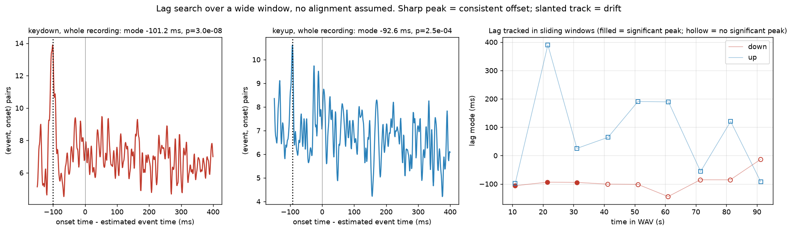
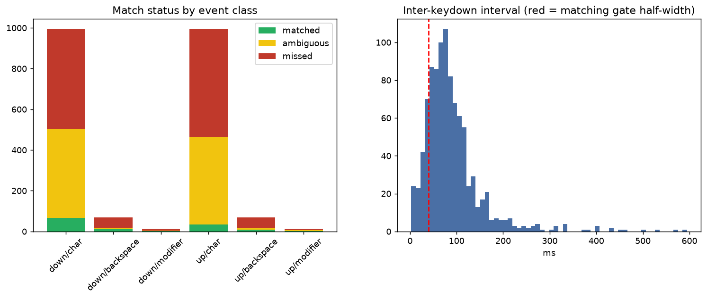
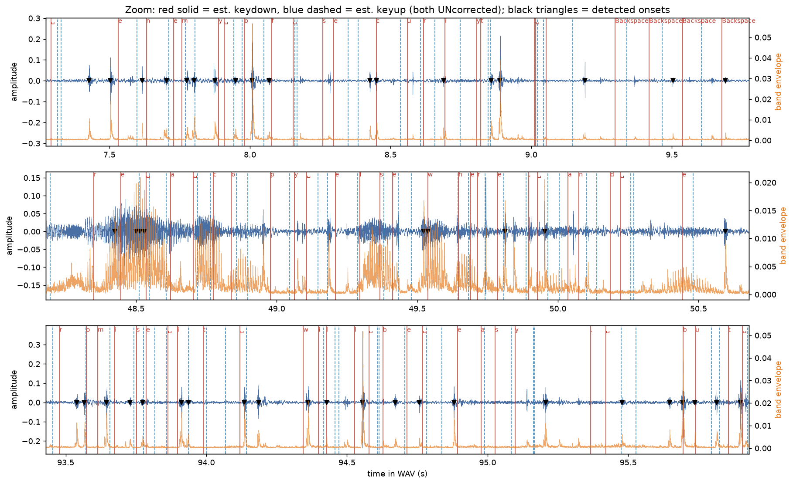
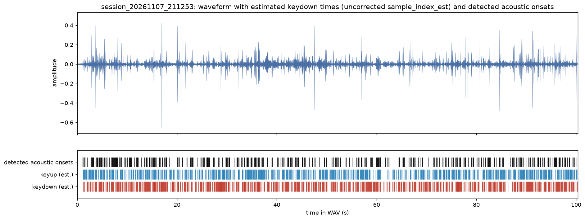
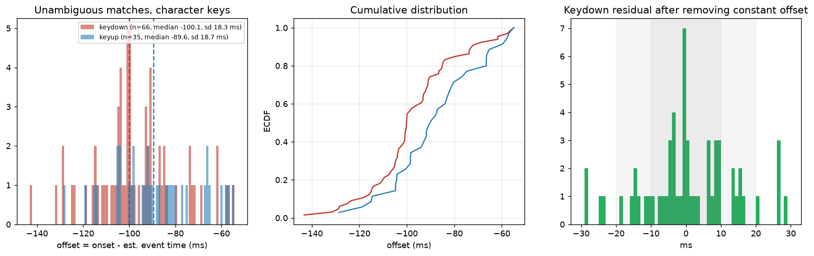
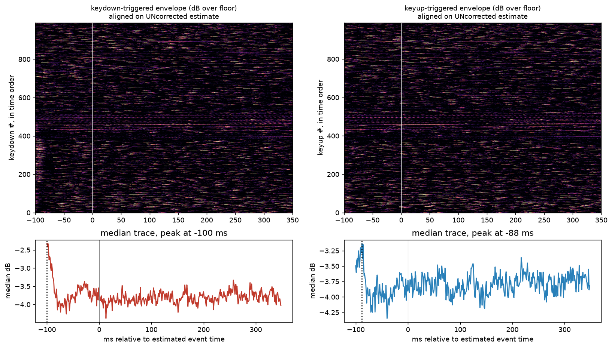
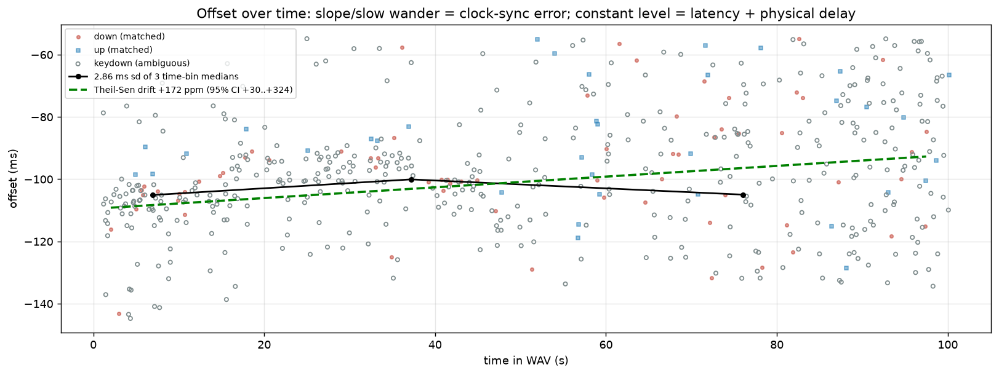

# Synchronisation report: session_20261107_211253

* WAV: `recordings/session_20261107_211253\audio.wav`  (100.33 s, 48000 Hz)
* keystrokes.csv: `recordings/session_20261107_211253\keystrokes.csv`
* metadata.json: `recordings/session_20261107_211253\metadata.json`

## Acoustic transient detection

Band-pass 1500-10000 Hz (zero-phase, so no delay is added), 0.5 ms RMS envelope, peaks > 4.0x the rolling 1 s median floor, onset = leading edge where the envelope first rises 20% of the way from floor to peak. **617 onsets** (6.15/s).

## Events

2152 events (1076 keydown, 1076 keyup). 0 auto-repeat keydowns are excluded from matching because a held key makes no new sound. Offsets below are `onset - sample_index_est/sample_rate`; positive = sound later than the estimate.

## 1. Does a timing relationship exist? (lag search, no alignment assumed)

All (onset - event) differences within the window were histogrammed. A peak is called significant when the number of pairs within +/-3 ms of the mode is implausible under the measured background rate (Poisson p < 1e-6) and the peak is at least 3x the background. This is done for the whole recording and again in sliding 20 s windows; the matching gate follows the *tracked* lag, so drift cannot push real onsets out of the window.

| class | whole-recording mode (ms) | p-value | significant | windows significant | tracked lag range (ms) | search window (ms) |
|---|---|---|---|---|---|---|
| down | -101.2 | 3.0e-08 | no | 3/9 (**NO**) | -106.5 .. -93.8 | -150 .. 400 |
| up | -92.6 | 2.5e-04 | no | 0/9 (**NO**) | n/a | -150 .. 400 |

If the whole-recording peak is weak but most windows are significant with a moving mode, the offset is **drifting** (a sync error), not absent.

Note: keyups matched around the keydown lag (shared input path); keyup free-search mode -92.6 ms is diagnostic only (a negative value indicates rollover onto the next key's press).

## 2. Matching, missed detections and ambiguity

Each eligible event gets a window of +/-40 ms around (estimate + its class's lag mode). *matched* = exactly one onset in the window and no other event claims it; *ambiguous* = several onsets in the window, or the onset is also in another event's window (typical in fast typing, including a release click landing in the next press window); *missed* = no onset in the window.

| class/category | eligible | matched | ambiguous | missed | miss rate |
|---|---|---|---|---|---|
| down/char | 994 | 66 | 436 | 492 | 49.5% |
| down/backspace | 68 | 13 | 3 | 52 | 76.5% |
| down/modifier | 14 | 1 | 3 | 10 | 71.4% |
| up/char | 994 | 35 | 430 | 529 | 53.2% |
| up/backspace | 68 | 8 | 10 | 50 | 73.5% |
| up/modifier | 14 | 1 | 6 | 7 | 50.0% |

Onsets not inside any event window: **41** (6.6% of all onsets): other sounds (speech, desk, mouse, touchpad), quiet keys detected late, or windows the gate excluded.

Gate check: nearest onset in the full lag window for each character keydown lies inside the gate for **53.0%**; a low value means the gate is cutting off a real tail and the statistics below under-state the spread.

## 3. Offset statistics (ms; onset - estimate)

| set | n | mean | median | std | robust sigma (MAD) | 2.5%..97.5% | min..max | IQR |
|---|---|---|---|---|---|---|---|---|
| down/char/matched | 66 | -97.06 | -100.10 | 18.33 | 13.51 | -129.94 .. -57.25 | -143.23 .. -54.88 | 18.10 |
| down/backspace/matched | 13 | -91.07 | -84.35 | 15.27 | 17.67 | -114.90 .. -71.99 | -116.35 .. -71.79 | 25.25 |
| down/modifier/matched | 1 | -124.19 | -124.19 | 0.00 | 0.00 | -124.19 .. -124.19 | -124.19 .. -124.19 | 0.00 |
| up/char/matched | 35 | -87.82 | -89.58 | 18.67 | 19.03 | -120.35 .. -56.68 | -128.56 .. -55.10 | 23.77 |
| up/backspace/matched | 8 | -88.57 | -99.84 | 19.61 | 8.99 | -108.16 .. -64.79 | -109.38 .. -64.67 | 36.30 |
| up/modifier/matched | 1 | -108.96 | -108.96 | 0.00 | 0.00 | -108.96 .. -108.96 | -108.96 .. -108.96 | 0.00 |
| down/char/matched+ambiguous | 502 | -98.26 | -100.39 | 19.20 | 17.19 | -133.16 .. -57.55 | -144.73 .. -54.88 | 23.30 |
| up/char/matched+ambiguous | 465 | -95.74 | -95.06 | 21.56 | 24.93 | -133.18 .. -56.92 | -141.06 .. -54.69 | 32.92 |
| ungated nearest onset, keydown/char | 948 | -29.82 | -75.66 | 112.34 | 58.19 | -143.16 .. 298.65 | -149.77 .. 393.81 | 115.28 |

### Press versus release

Median offset for keydown **-100.1 ms**, for keyup **-89.6 ms** (difference +10.5 ms; sd 18.3 / 18.7 ms). Both go through the same input chain and clock mapping, so a shared constant offset points to latency / mapping. A *difference* between them is physical (release click timing versus when the OS reports the release) and cannot be a clock error. Every key can click on both press and release, so release events are matched in their own class rather than counted as misses of the press.

## 4. Clock-synchronisation error versus input latency

* **Offset is not constant**: it moves from **-109.2 ms** at the start of typing (t=2 s) to **-92.7 ms** at the end (t=97 s). A single median would mix the two, so it is not reported as 'the latency'. The *level* (offset at the start) is input latency + physical key delay + constant mapping bias + detector definition; the *change* is clock-synchronisation error, because input latency does not grow during a recording.
* **Drift (clock rate mismatch)**: Theil-Sen slope **+172 ppm** (95% CI +30 .. +324); accumulates **+16.4 ms** across the typed span. A CI excluding 0 means the sync model's slope is measurably wrong; real oscillators differ by <~100 ppm.
* **Slow wander** (medians of 10 s bins): sd **2.86 ms**, range -105.1 .. -100.1 ms. Time-varying, so this is sync error (or changing buffer fill), not a fixed latency.
* **Fast jitter** (per-event scatter around the bin median): sd **16.47 ms**. Mixes physical key-travel variation, event dispatch jitter, and detector error; it is a floor on how well *any* timestamp can predict the onset.
* Median offset in first / middle / last third of the typing: -102.8, -100.1, -88.8 ms.

Same matched onsets re-timed with each clock mapping saved in metadata.json (primary = `output_timestamp`):

| mapping | median offset (ms) | std (ms) | slope source | effective rate (Hz) | its own fit residual RMS (ms) |
|---|---|---|---|---|---|
| output_timestamp | -100.1 | 18.33 | nominal | 48000.0 | 60.05 |
| current_time | -146.1 | 18.33 | nominal | 48000.0 | 61.00 |
| worklet_arrival | -147.6 | 18.33 | nominal | 48000.0 | 59.74 |

The spread of medians across mappings is mapping uncertainty alone; the page's own sync-fit residual shows how well it tracked its clock pairs, which says nothing about microphone input latency.

## 5. Sensitivity to detector settings

The headline offset depends on how 'onset' is defined (a later threshold crossing gives a later onset). If the median moves by several ms across rows, treat the constant offset as uncertain by that much.

| threshold (x floor) | rise fraction | onsets | matched | ambiguous | missed | median (ms) | std (ms) |
|---|---|---|---|---|---|---|---|
| 3 | 0.1 | 841 | 95 | 530 | 369 | -99.0 | 18.93 |
| 3 | 0.2 | 841 | 94 | 532 | 368 | -99.4 | 18.82 |
| 3 | 0.5 | 841 | 97 | 527 | 370 | -98.3 | 18.61 |
| 4 | 0.1 | 617 | 67 | 434 | 493 | -100.1 | 18.52 |
| 4 | 0.2 | 617 | 66 | 436 | 492 | -100.1 | 18.33 |
| 4 | 0.5 | 617 | 68 | 433 | 493 | -99.7 | 18.19 |
| 6 | 0.1 | 413 | 42 | 322 | 630 | -100.3 | 18.46 |
| 6 | 0.2 | 413 | 41 | 325 | 628 | -100.2 | 18.17 |
| 6 | 0.5 | 413 | 43 | 321 | 630 | -100.0 | 17.99 |
| 10 | 0.1 | 240 | 29 | 209 | 756 | -96.4 | 18.72 |
| 10 | 0.2 | 240 | 28 | 212 | 754 | -98.2 | 18.38 |
| 10 | 0.5 | 240 | 28 | 210 | 756 | -98.0 | 18.13 |

Median offset ranges over **-100.3 .. -96.4 ms** across detector settings.

## 6. Can we cut labelled per-keystroke clips?

| criterion | value | threshold | pass |
|---|---|---|---|
| significant lag peak in a majority of time windows (keydown) | 3/9 | >= 50% | **NO** |
| detection rate, char keydowns | 50.5% | >= 90% | **NO** |
| unambiguous one-to-one matches | 6.6% | >= 80% | **NO** |
| p95 abs residual, constant offset removed | 41.4 ms | <= 10.0 ms | **NO** |

With the slow component also removed the p95 residual would be 34.0 ms (this is what an offset that tracks drift could reach).

Fraction of character keydown onsets landing within +/-X ms of (estimate + constant offset): 5 ms: 33%, 10 ms: 55%, 20 ms: 74%, 30 ms: 88%, 50 ms: 100%.

Crowding (another key press or release within +/-W of a character keydown): 50ms: 85%, 100ms: 100%, 150ms: 100%.

Drift is significant, so a constant offset is the wrong model. After removing a fitted *line* (offset + drift) the p95 residual is **36.3 ms**.

* **Fixed-offset clips** (cut at estimate + one constant offset, no re-anchoring): **NOT supported** at this precision.
* **Offset + linear drift clips** (cut at estimate + fitted line): **NOT supported** (p95 residual 36.3 ms vs 10.0 ms).
* **Onset-snapped clips** (find the onset near each estimate, cut around it, label from the matching keystroke): **NOT supported** for the 7% of keystrokes with an unambiguous match; ambiguous and missed keystrokes should be dropped or reviewed rather than labelled by guess.

## 7. Suggested correction (NOT applied)

The evidence supports a *line*, not a constant: offset(t) = **-109.2 ms** at t=2 s, changing at **+172 ppm** (detector-setting range of the level -100.3 .. -96.4 ms; see sections 3-5). 
`keystrokes.csv` and `metadata.json` are untouched. To write a *copy* with an extra `sample_index_corrected` column once you have decided to use it: 
`python analysis/sync_analysis.py recordings/session_20261107_211253\audio.wav --write-corrected-csv -109.2 --corrected-drift-ppm 172 --corrected-ref-s 2.0`

## Limitations

* Onset detection is a heuristic; a quiet key, overlapping keys or room noise change what is found. The sensitivity table bounds this but does not remove it.
* The keyboard event time is not the moment of finger contact: switch actuation and key travel add a physical delay of a few ms to tens of ms that varies key to key, and it is folded into 'latency' above.
* This recording can show that offsets are stable or drifting; it cannot split input latency from physical delay without an independent reference (e.g. a loopback or a known acoustic source).

## Files

* `01_overview_waveform.png`
* `02_zoom_windows.png`
* `03_lag_search.png`
* `04_offset_distribution.png`
* `05_offset_vs_time.png`
* `06_event_triggered_envelope.png`
* `07_match_status_and_intervals.png`
* `event_matches.csv`
* `sync_stats.json`
