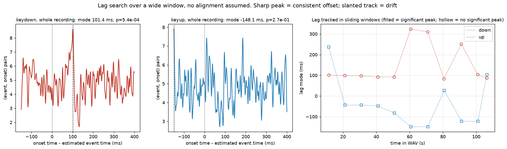
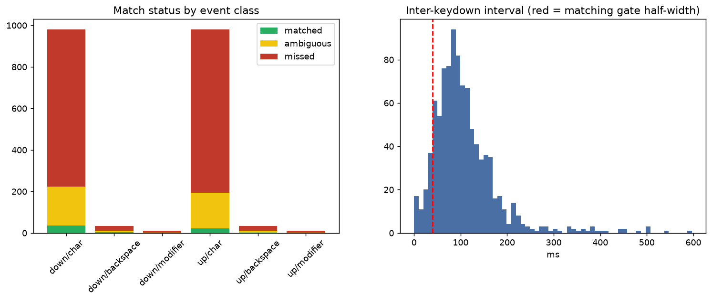
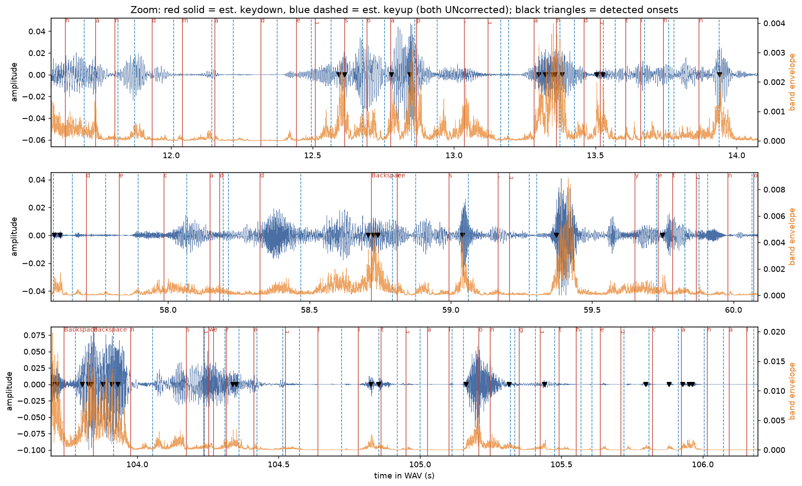
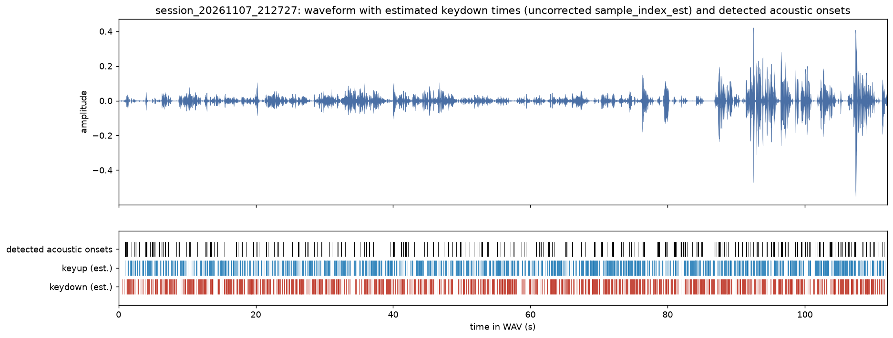
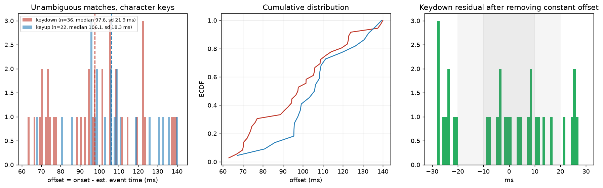
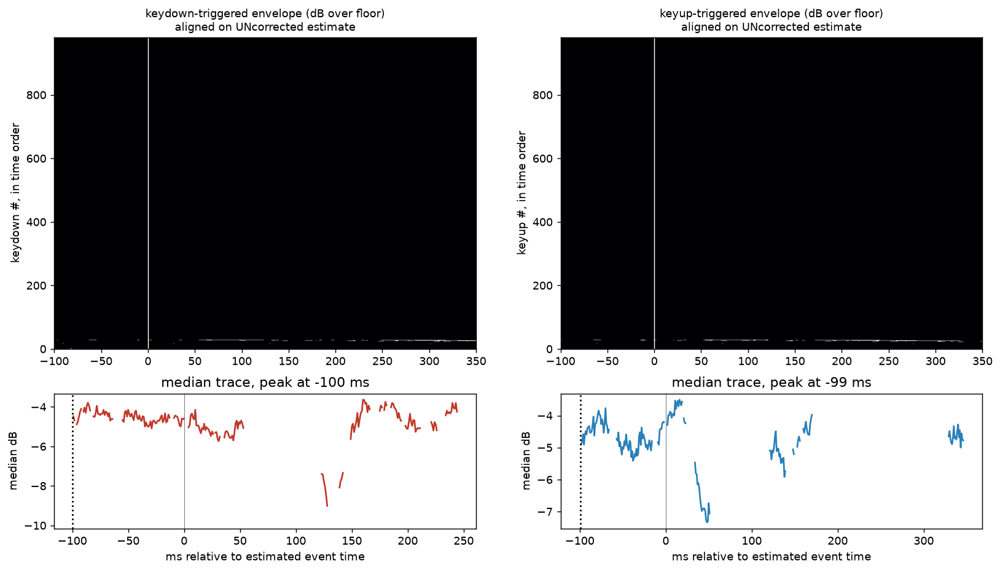
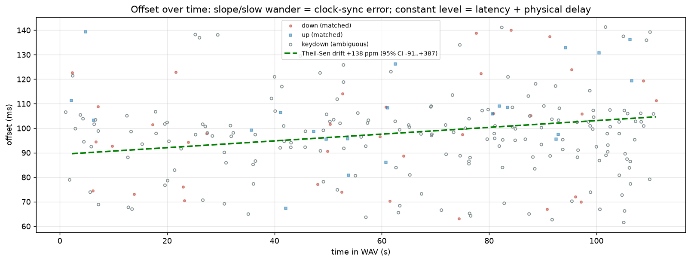

# Synchronisation report: session_20261107_212727

* WAV: `recordings/session_20261107_212727\audio.wav`  (111.98 s, 48000 Hz)
* keystrokes.csv: `recordings/session_20261107_212727\keystrokes.csv`
* metadata.json: `recordings/session_20261107_212727\metadata.json`

## Acoustic transient detection

Band-pass 1500-10000 Hz (zero-phase, so no delay is added), 0.5 ms RMS envelope, peaks > 4.0x the rolling 1 s median floor, onset = leading edge where the envelope first rises 20% of the way from floor to peak. **551 onsets** (4.92/s).

## Events

2050 events (1025 keydown, 1025 keyup). 0 auto-repeat keydowns are excluded from matching because a held key makes no new sound. Offsets below are `onset - sample_index_est/sample_rate`; positive = sound later than the estimate.

## 1. Does a timing relationship exist? (lag search, no alignment assumed)

All (onset - event) differences within the window were histogrammed. A peak is called significant when the number of pairs within +/-3 ms of the mode is implausible under the measured background rate (Poisson p < 1e-6) and the peak is at least 3x the background. This is done for the whole recording and again in sliding 20 s windows; the matching gate follows the *tracked* lag, so drift cannot push real onsets out of the window.

| class | whole-recording mode (ms) | p-value | significant | windows significant | tracked lag range (ms) | search window (ms) |
|---|---|---|---|---|---|---|
| down | 101.4 | 5.4e-04 | no | 0/11 (**NO**) | n/a | -150 .. 400 |
| up | -148.1 | 2.7e-01 | no | 0/11 (**NO**) | n/a | -150 .. 400 |

If the whole-recording peak is weak but most windows are significant with a moving mode, the offset is **drifting** (a sync error), not absent.

Note: keyups matched around the keydown lag (shared input path); keyup free-search mode -148.1 ms is diagnostic only (a negative value indicates rollover onto the next key's press).

## 2. Matching, missed detections and ambiguity

Each eligible event gets a window of +/-40 ms around (estimate + its class's lag mode). *matched* = exactly one onset in the window and no other event claims it; *ambiguous* = several onsets in the window, or the onset is also in another event's window (typical in fast typing, including a release click landing in the next press window); *missed* = no onset in the window.

| class/category | eligible | matched | ambiguous | missed | miss rate |
|---|---|---|---|---|---|
| down/char | 981 | 36 | 187 | 758 | 77.3% |
| down/backspace | 34 | 3 | 8 | 23 | 67.6% |
| down/modifier | 10 | 0 | 2 | 8 | 80.0% |
| up/char | 981 | 22 | 171 | 788 | 80.3% |
| up/backspace | 34 | 1 | 9 | 24 | 70.6% |
| up/modifier | 10 | 0 | 1 | 9 | 90.0% |

Onsets not inside any event window: **91** (16.5% of all onsets): other sounds (speech, desk, mouse, touchpad), quiet keys detected late, or windows the gate excluded.

Gate check: nearest onset in the full lag window for each character keydown lies inside the gate for **29.2%**; a low value means the gate is cutting off a real tail and the statistics below under-state the spread.

## 3. Offset statistics (ms; onset - estimate)

| set | n | mean | median | std | robust sigma (MAD) | 2.5%..97.5% | min..max | IQR |
|---|---|---|---|---|---|---|---|---|
| down/char/matched | 36 | 98.07 | 97.61 | 21.95 | 31.10 | 66.48 .. 139.05 | 63.02 .. 140.00 | 36.28 |
| down/backspace/matched | 3 | 83.90 | 81.75 | 19.98 | 24.71 | 65.92 .. 103.72 | 65.08 .. 104.87 | 19.90 |
| up/char/matched | 22 | 106.99 | 106.06 | 18.26 | 15.43 | 74.45 .. 137.74 | 67.38 .. 139.40 | 21.19 |
| up/backspace/matched | 1 | 96.90 | 96.90 | 0.00 | 0.00 | 96.90 .. 96.90 | 96.90 .. 96.90 | 0.00 |
| down/char/matched+ambiguous | 223 | 96.78 | 97.77 | 17.75 | 13.37 | 64.98 .. 138.16 | 61.52 .. 141.29 | 19.04 |
| up/char/matched+ambiguous | 193 | 102.94 | 103.00 | 20.46 | 20.32 | 64.10 .. 139.18 | 61.75 .. 141.29 | 27.21 |
| ungated nearest onset, keydown/char | 763 | 110.06 | 100.94 | 129.18 | 137.88 | -126.43 .. 364.51 | -147.65 .. 399.79 | 181.83 |

### Press versus release

Median offset for keydown **97.6 ms**, for keyup **106.1 ms** (difference +8.4 ms; sd 21.9 / 18.3 ms). Both go through the same input chain and clock mapping, so a shared constant offset points to latency / mapping. A *difference* between them is physical (release click timing versus when the OS reports the release) and cannot be a clock error. Every key can click on both press and release, so release events are matched in their own class rather than counted as misses of the press.

## 4. Clock-synchronisation error versus input latency

* **Constant component**: median keydown offset **97.6 ms**, no significant drift. This is the sum of microphone/driver/browser input latency, the physical delay between finger contact and the OS key event, any constant bias in the clock mapping, and the detector's definition of 'onset'. These cannot be separated by this recording alone; they are not clock *error* because they do not change over time.
* **Drift (clock rate mismatch)**: Theil-Sen slope **+138 ppm** (95% CI -91 .. +387); accumulates **+15.0 ms** across the typed span. A CI excluding 0 means the sync model's slope is measurably wrong; real oscillators differ by <~100 ppm.
* Median offset in first / middle / last third of the typing: 94.4, 93.6, 108.6 ms.

Same matched onsets re-timed with each clock mapping saved in metadata.json (primary = `output_timestamp`):

| mapping | median offset (ms) | std (ms) | slope source | effective rate (Hz) | its own fit residual RMS (ms) |
|---|---|---|---|---|---|
| output_timestamp | 97.6 | 21.95 | fitted | 48000.0 | 3.67 |
| current_time | 97.6 | 21.94 | fitted | 48000.0 | 3.67 |
| worklet_arrival | 97.0 | 22.00 | fitted | 47999.6 | 4.64 |

The spread of medians across mappings is mapping uncertainty alone; the page's own sync-fit residual shows how well it tracked its clock pairs, which says nothing about microphone input latency.

## 5. Sensitivity to detector settings

The headline offset depends on how 'onset' is defined (a later threshold crossing gives a later onset). If the median moves by several ms across rows, treat the constant offset as uncertain by that much.

| threshold (x floor) | rise fraction | onsets | matched | ambiguous | missed | median (ms) | std (ms) |
|---|---|---|---|---|---|---|---|
| 3 | 0.1 | 805 | 47 | 270 | 664 | 94.2 | 21.21 |
| 3 | 0.2 | 805 | 48 | 267 | 666 | 95.0 | 20.54 |
| 3 | 0.5 | 805 | 49 | 266 | 666 | 96.3 | 20.76 |
| 4 | 0.1 | 551 | 35 | 190 | 756 | 96.5 | 22.79 |
| 4 | 0.2 | 551 | 36 | 187 | 758 | 97.6 | 21.95 |
| 4 | 0.5 | 551 | 37 | 184 | 760 | 97.8 | 21.47 |
| 6 | 0.1 | 313 | 30 | 91 | 860 | 91.8 | 22.32 |
| 6 | 0.2 | 313 | 31 | 90 | 860 | 92.6 | 21.35 |
| 6 | 0.5 | 313 | 30 | 89 | 862 | 93.4 | 20.96 |
| 10 | 0.1 | 145 | 14 | 42 | 925 | 91.2 | 21.05 |
| 10 | 0.2 | 145 | 15 | 40 | 926 | 91.3 | 17.34 |
| 10 | 0.5 | 145 | 16 | 38 | 927 | 94.2 | 17.03 |

Median offset ranges over **91.2 .. 97.8 ms** across detector settings.

## 6. Can we cut labelled per-keystroke clips?

| criterion | value | threshold | pass |
|---|---|---|---|
| significant lag peak in a majority of time windows (keydown) | 0/11 | >= 50% | **NO** |
| detection rate, char keydowns | 22.7% | >= 90% | **NO** |
| unambiguous one-to-one matches | 3.7% | >= 80% | **NO** |
| p95 abs residual, constant offset removed | 40.2 ms | <= 10.0 ms | **NO** |

With the slow component also removed the p95 residual would be 40.2 ms (this is what an offset that tracks drift could reach).

Fraction of character keydown onsets landing within +/-X ms of (estimate + constant offset): 5 ms: 22%, 10 ms: 36%, 20 ms: 47%, 30 ms: 86%, 50 ms: 100%.

Crowding (another key press or release within +/-W of a character keydown): 50ms: 76%, 100ms: 99%, 150ms: 100%.

* **Fixed-offset clips** (cut at estimate + one constant offset, no re-anchoring): **NOT supported** at this precision.
* **Offset + linear drift clips** (cut at estimate + fitted line): **NOT supported** (p95 residual 37.1 ms vs 10.0 ms).
* **Onset-snapped clips** (find the onset near each estimate, cut around it, label from the matching keystroke): **NOT supported** for the 4% of keystrokes with an unambiguous match; ambiguous and missed keystrokes should be dropped or reviewed rather than labelled by guess.

## 7. Suggested correction (NOT applied)

Evidence-backed constant offset: **+97.6 ms** (keydown median; detector-setting range 91.2 .. 97.8 ms; see sections 3-5). `keystrokes.csv` and `metadata.json` are untouched. To write a *copy* with an extra `sample_index_corrected` column using a value you have decided on: `python analysis/sync_analysis.py recordings/session_20261107_212727\audio.wav --write-corrected-csv <ms>`.

## Limitations

* Onset detection is a heuristic; a quiet key, overlapping keys or room noise change what is found. The sensitivity table bounds this but does not remove it.
* The keyboard event time is not the moment of finger contact: switch actuation and key travel add a physical delay of a few ms to tens of ms that varies key to key, and it is folded into 'latency' above.
* This recording can show that offsets are stable or drifting; it cannot split input latency from physical delay without an independent reference (e.g. a loopback or a known acoustic source).

## Files

* `01_overview_waveform.png`
* `02_zoom_windows.png`
* `03_lag_search.png`
* `04_offset_distribution.png`
* `05_offset_vs_time.png`
* `06_event_triggered_envelope.png`
* `07_match_status_and_intervals.png`
* `event_matches.csv`
* `sync_stats.json`
